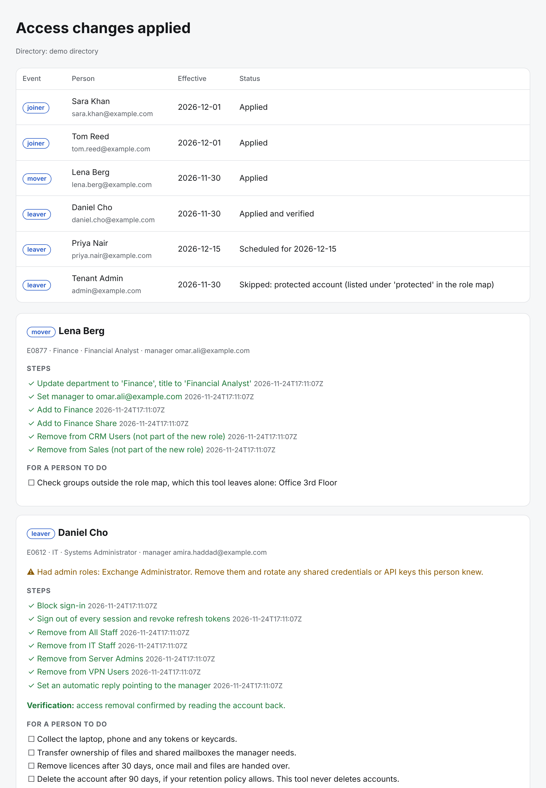

# Joiner, mover and leaver automation

[](https://github.com/arafathossein/joiner-leaver-automation/actions/workflows/tests.yml)

**New starters get the right access on day one. Leavers lose all of it on their last day, with proof.** This tool reads joiner, mover and leaver events from HR, works out exactly what has to change in Microsoft 365 (Entra ID) or Google Workspace, shows you the plan, and then makes the changes and records each one.

Nothing changes until you run `apply`. Accounts are never deleted. Privileged roles wait for a second person's approval.

Built by [AFYRA Technologies](https://afyra-iota.vercel.app).



*Rendered from the bundled samples with `jml demo`. People and the company are fictional.*

## Why

Onboarding and offboarding happen every month at every company, and are still often a chain of emails and tickets. Slow onboarding means a new hire without email on day one. Slow offboarding is worse: a former employee who can still sign in weeks later. It's one of the first things an auditor checks ("show me that leavers lost access on time"), and one of the most common findings.

## What it does

| Event | Changes | Left for a person |
| --- | --- | --- |
| **Joiner** | Create the account, set the manager, assign licences, add role groups, issue a [Temporary Access Pass](https://learn.microsoft.com/entra/identity/authentication/howto-authentication-temporary-access-pass) (or a temporary password) | Hand over the credential separately, laptop, MFA enrolment |
| **Mover** | Update department and title, set the new manager, add the new role's groups, remove groups from the old role | Groups outside the role map, admin roles |
| **Leaver** | Block sign-in, revoke every session, remove from all groups, set an auto-reply to the manager, then read the account back to verify | Devices, file and mailbox handover, licence removal after 30 days, deletion after 90 days, apps without single sign-on |

### Built to be safe

- **Dry run first.** `plan` shows every change and touches nothing. `apply` does it.
- **Idempotent.** Plans are built against what the directory already says. Running the same file again does nothing, so a failed run can simply be repeated.
- **Only what the role map manages.** When someone changes role, the tool removes groups that belong to the old role in the role map. Groups it doesn't know about are listed for a person to check, never removed.
- **Protected accounts.** Break-glass and admin accounts listed under `protected` are never touched, whatever the HR feed says.
- **Review for privileged access.** Roles marked `review: true` (IT admins, say) are planned but not applied until someone passes `--approved-by`.
- **Leavers wait for their date.** A leaver dated next week is shown as scheduled. Joiners can be prepared ahead.
- **No deletions.** Accounts are disabled, not deleted; deletion is a manual step after your retention period.
- **Secrets stay out of logs.** A Temporary Access Pass or password goes to a file readable only by you (`reports/secrets/`, mode 600). It never appears in the audit log or the reports.
- **Evidence.** `reports/audit.jsonl` records every step with a UTC timestamp, and leavers are checked by reading the account back after the changes.

## Quick start

```bash
python -m venv .venv && source .venv/bin/activate     # Windows: .venv\Scripts\activate
pip install -e ".[dev]"

jml demo                      # sample events against a demo directory: plan, apply, plan again
pytest                        # 28 tests
```

### Your HR events

A CSV export from the HR system (or a JSON list with the same keys):

```csv
kind,employee_id,email,first_name,last_name,department,title,manager_email,effective_date
joiner,E1042,sara.khan@example.com,Sara,Khan,Finance,Accounts Payable Clerk,omar.ali@example.com,2026-12-01
mover,E0877,lena.berg@example.com,Lena,Berg,Finance,Financial Analyst,omar.ali@example.com,2026-11-30
leaver,E0612,daniel.cho@example.com,Daniel,Cho,IT,Systems Administrator,amira.haddad@example.com,2026-11-30
```

### Your role map

```yaml
domain: example.com
usage_location: GB
credential: tap                     # or: password
baseline:
  groups: [All Staff, VPN Users]
  licences: [SPB]                   # SKU part number, resolved through /subscribedSkus
roles:
  - match: {department: Finance}
    groups: [Finance, Finance Share]
  - match: {department: Finance, title: "Accounts Payable*"}
    groups: [AP Approvers]
  - match: {department: IT}
    groups: [IT Staff, Server Admins]
    review: true
protected: [admin@example.com, breakglass-01@example.com]
```

Rules add up: an Accounts Payable Clerk in Finance gets the baseline, the Finance groups and AP Approvers. See [`samples/roles.yaml`](samples/roles.yaml) for every option.

### Microsoft 365 / Entra ID

Create an app registration with these **application** permissions and grant admin consent:

| Permission | Used for |
| --- | --- |
| `User.ReadWrite.All` | create, update, block sign-in, revoke sessions |
| `GroupMember.ReadWrite.All` | add and remove group members |
| `Directory.Read.All` | read admin roles and group names |
| `MailboxSettings.ReadWrite` | leaver auto-reply |
| `UserAuthenticationMethod.ReadWrite.All` | Temporary Access Pass |

Temporary Access Pass must be enabled in Entra ID's authentication methods policy; otherwise set `credential: password`.

```bash
export GRAPH_TENANT_ID=... GRAPH_CLIENT_ID=... GRAPH_CLIENT_SECRET=...
jml plan  hr-events.csv --roles roles.yaml --provider graph
jml apply hr-events.csv --roles roles.yaml --provider graph --approved-by "A. Haddad"
```

Throttled requests (HTTP 429) and server errors are retried with back-off.

### Google Workspace

Use a service account with domain-wide delegation and the scopes `admin.directory.user` and `admin.directory.group.member`. Groups in the role map are group addresses; `Finance Share` becomes `finance-share@<domain>`.

```bash
pip install -e ".[google]"
export GOOGLE_SA_KEY_FILE=sa.json GOOGLE_ADMIN_EMAIL=admin@example.com
jml plan hr-events.csv --roles roles.yaml --provider google
```

Licences and Gmail auto-replies aren't changed through the Directory API, so with Google they appear in the plan as steps for a person.

### Exit codes

`0` done, `1` bad input or connection, `2` a step failed or a leaver didn't verify. Use them to alert from a scheduled job.

## Limits

- Admin roles are reported, not removed: removing them is a decision for a person.
- Mailbox conversion, file ownership transfer and licence removal are listed as manual steps.
- The tool trusts the HR file. Protect the folder it's read from as you would any access-control input.
- Tested against mocked Graph and Directory APIs with the documented request and response shapes. Try it on a test tenant first.

## Project layout

```
src/jml/
  config.py          HR events and role map, with validation
  planner.py         joiner / mover / leaver plans against current state
  executor.py        apply, audit log, private secrets file, leaver verification
  providers/         graph.py (Microsoft Graph), google.py (Admin SDK), memory.py (demo)
  report.py          Markdown and HTML plan / evidence
  cli.py
samples/             fictional events, role map and directory
```

## Roadmap

- Read events straight from BambooHR, Personio or HiBob
- Remove admin role assignments after approval
- Weekly report of accounts with no matching HR record

## License

MIT, see [LICENSE](LICENSE).
